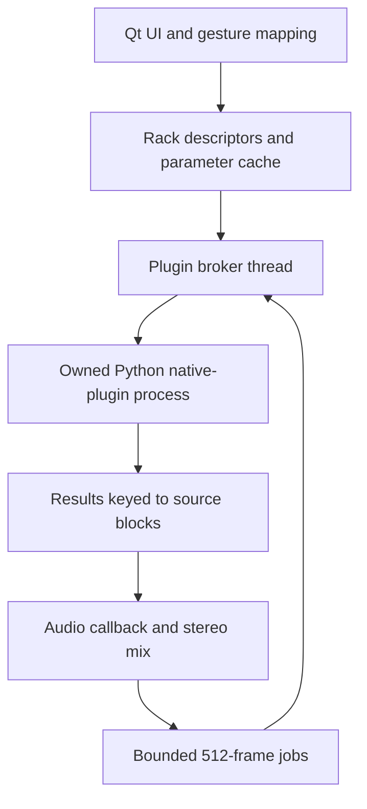

# TouchMusic architecture

Development snapshot: 0.5.0.dev3. Requirements and delivery status live only in [roadmap.md](../roadmap.md).

## Runtime boundaries

The GUI process hosts the built-in Pedalboard effects, looper, recorder and camera UI. External VST3 DLLs are loaded only by `plugin_worker.py` in an owned child. One child contains the complete four-slot effect rack. A crash bypasses the complete external rack; it does not isolate each effect from the other effects. Python exception handling alone cannot contain a native access violation, hence the process boundary.

`PluginRack` remains the worker-side backend and supports injected fake loaders in regression tests. `IsolatedPluginRack` is the desktop facade. It exposes the existing settings/order/bypass/bindings API without holding native plugin objects.

This is fault containment, not a security sandbox for hostile binaries. A plugin runs with the current user's OS permissions.

## Audio and timing

- Device input and the local AI converter remain mono at 48 kHz. The device block size remains 512 frames.
- The external effect chain can produce two independent channels. These survive the stereo master, device callback and new stereo performance/stem recordings.
- Existing `AudioEngine.process(audio)` callers receive the compatible mono mix. `stereo=True` returns samples by channels. Worker PCM uses channels by samples.
- Existing loop captures and backing/reference assets remain mono. Wet loop capture explicitly downmixes the two channels to preserve the old loop/archive representation. Stereo assets require the planned migration.
- The callback accumulates variable-sized render segments into 512-frame plugin jobs. It never waits on pipe IO or native processing.
- The worker pipeline adds exactly 2048 scheduled frames, 42.667 ms at 48 kHz, when the external rack is populated. Empty racks add no worker delay. This excludes plugin DSP, built-in DSP, AI and device latency.
- Every wet result belongs to its original input block. An unavailable result uses the corresponding delayed dry block. Late results cannot slide into a later block. Six queued jobs and about five timeline blocks bound callback-side storage.
- A slow or dead worker can cause audible fallback changes. Crossfading wet/fallback, measured plugin latency compensation and reducing worker delay are open work, not hidden guarantees.
- Recording provenance receives the same worker delay as the vocal stream, preserving converter/source-frame mapping. It does not compensate an unknown third-party plugin's internal latency.

The broker sends only parameter changes. It retains the latest normalized target in a bounded descriptor map instead of dropping a final gesture when a plugin is busy. Broker/native processing still runs under general-purpose Python/OS scheduling; this is not a hard real-time guarantee.

## Worker protocol and lifecycle

RPC is bounded UTF-8 JSON lines, at most 2 MiB per message. PCM is finite float32, base64 encoded, with explicit dimensions; each accepted audio message has one/two channels and at most 8192 frames. No Python pickle or arbitrary command evaluation is used. Native stdout is redirected away from the protocol pipe before loading DLLs.

Configuration is transactional: a candidate process must load the complete requested rack before replacing the current one. A failed load retains the previous process and cached descriptors. Native calls have an owned-process kill watchdog. Native editor calls intentionally remain open until the user closes the window or the application kills its child on shutdown.

Structural operations occur with audio stopped. Stream reset drains the previous broker generation, resets native audio buffers, then starts a fresh bounded pipeline without discarding the native editor's current runtime state. Explicit Restart reloads captured native state plus normalized controls. No automatic crash/restart loop repeatedly loads a faulty binary.

At shutdown TouchMusic stops scanning/audio, requests native editors close, captures available stopped-worker state, cancels candidate loads and closes owned children/conversion resources. A worker reader detects parent EOF and exits even while a native editor is open. Other applications and unrelated processes are never terminated.

## Plugin Center and compatibility

Discovery enumerates paths, treating a `.vst3` directory as one bundle. It does not instantiate plugins. Explicit scans use a separate worker and produce binary-hash/version/rate/block/parameter/impulse/RPC evidence. A failure quarantines that Plugin Center entry until a successful rescan. The direct FX file picker remains an explicit advanced loading path.

The catalog separates official publisher identity, license label, reviewed download asset and measured compatibility. Pinned downloads are TDR Nova 2.2.3, SnapTune 2.4.0, LyraTune 0.6.7 and Surge XT 1.3.4. It is staged as an archive and never automatically executed/extracted. The SHA-256 is an observed integrity pin, not a publisher signature. Community catalogs are reference material only.

Native editors use the actual loaded plugin instance on the worker's main thread. The GUI remains available; audio start and rack changes are blocked until the editor closes. Exposed parameters synchronize afterward. Opaque state captures in bounded chunks and persists in the content-addressed StateStore and optional project ZIP entries. Structural tasks run off the GUI thread; a lifecycle epoch prevents a candidate load committing after shutdown.

## Gesture Learn and Motion Score

Gesture Learn temporarily disarms performance output. It establishes axis baselines, accepts a deliberate dominant movement, binds the chosen plugin knob, and times out after ten seconds. Pose actions do not execute during learning.

Motion Score v1 stores at most 4096 finite beat-ordered events. Targets are validated against supported movement/action names. Recording captures filtered movement values and deliberate physical pose actions, so a macro is recorded once rather than duplicated with every expanded action. Playback calls the existing gesture dispatchers and never starts merely because a project was opened. Rehearsal and learning remain separate modes.

MotionTransport splits local rendering at event sample boundaries, tracks beats as tempo changes and limits event work to 128 events per processing call. Local DSP/loop/chord/note commands run there. A bounded 1024-item relay, drained by a 10 ms Qt timer, carries voice/macros/external MIDI and UI feedback. Tokens invalidate stopped scores. Plugin knobs still apply at worker boundaries; this is not sample-accurate DAW automation. Envelope editing and host-seek semantics remain open.

## DAW and instrument boundaries

The existing VST3 Control Bridge remains version 0.4.0 and retains its protocol/UID/ten controls. It passes DAW audio unchanged and emits bounded automation/timing packets to an opt-in loopback receiver. It is separate from the isolated external-FX worker. Dev2 adds a separate live Audio Bridge and isolated instrument/MIDI synthesis bus, described below. Full latency compensation, extended instrument certification and actual DAW checks remain pending.

## Compatibility contract

Existing v1 performance archives, normalized FX settings and gesture mappings remain readable. New Motion Score data is optional and never auto-plays. A saved external rack still requires explicit review/load. Preserving old mono loop assets avoids an untested schema change. Unknown/malformed automation is rejected before replacing a score. Optional plugin-state inventories extend v1 without changing legacy assets. New readers accept old archives; older readers can retain normalized fallback but cannot restore opaque snapshots. Future stereo assets and bridge state require checked migrations.

## dev2: separate synth and DAW audio buses

InstrumentBus reuses the owned-process pipeline with a separate InstrumentBackend. Timestamped channel-zero MIDI is rendered in the worker; bounded commands and a bounded event heap track note generations so an earlier note-off cannot terminate a retrigger. Panic invalidates old queued commands. Silent worker input means failure falls back to silence rather than microphone audio. The stereo synth is mixed after the vocal rack and exported as its own stem. Native instruments are never automatically loaded from a session.

The new Audio Bridge uses a distinct VST3 UID. Its audio callback only copies samples and exchanges bounded SPSC queues. A native network thread owns UDP; the Python receiver is loopback-only and processes one source at 48 kHz without a simultaneous PortAudio stream. Packet identity, source frame, shape, rate, kind and finite PCM are checked; duplicate/foreign packets are rejected. The DAW owns the input clock, eliminating a second device clock for this route. Missing returns use the matching delayed dry block.

The native plugin reports 4096 transport frames. This is not total AI/FX latency compensation: converter and effect-worker delays still apply, and parameter automation is not sample-accurate across the process boundary. Offline fast rendering and non-48-kHz wet return are explicitly unsupported. Actual native-host DSP return was checked; Real GPU conversion through the actual native host has also passed, with measured converter underruns. Physical FL Studio and conversion inside a DAW remain delegated and unverified.

## State and session ownership

Native state is limited to 8 MiB per blob and 32 MiB per project, transferred in 64 KiB chunks through the owned worker. SHA-256 addresses identify blobs; restores also require the captured plugin-binary hash. A candidate is fully configured before an atomic commit replaces the old worker. Native preset restoration precedes normalized overlay and binding validation. Missing/tampered state aborts the transaction; the old rack remains. Pedalboard's native raw_state descriptor is set directly, avoiding speculative parameter-name inference on large synths.

Native-load tasks return plain results to GUI polling; Qt widgets stay on the GUI thread. Closing increments the lifecycle epoch and terminates only owned candidates. Native editor close controls are read separately from the blocking editor RPC, while all DLL work stays on the worker main thread.

SingleInstance uses a per-data-directory QLockFile. A local Qt server focuses the owner; if named pipes are restricted, a bounded atomic request marker provides focus handoff. Independent data directories remain independent installations. Device monitoring stops an inactive stream and requires explicit refresh/reselection; it does not reopen another microphone automatically.

Instrument initialization, opaque restore, editor close and stream reset prepare 32 paced silent 512-frame blocks in the owned worker, off the GUI/audio callback. This allows deferred vendor preset loads to settle before accepting notes. The native parameter snapshot is replaced after initialization/restoration so removed or newly exposed parameters are reflected. This finite window is tested for Surge XT 1.3.4, not a guarantee for every synth.
